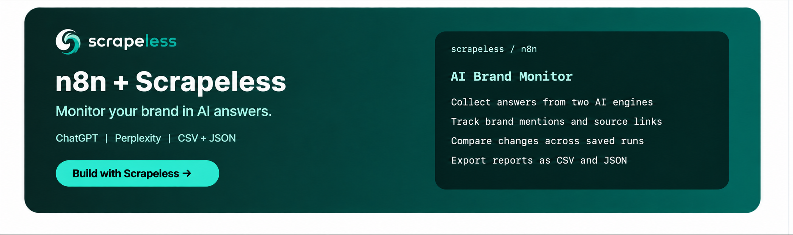
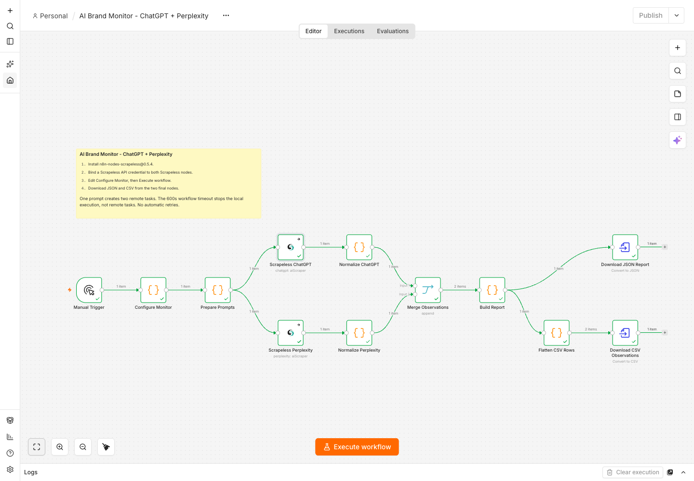

[](https://app.scrapeless.com/passport/login?redirect=%2Fquick-start&utm_source=github&utm_medium=referral&utm_campaign=scrapeless-n8n-ai-brand-monitor&utm_content=repository-readme)

# scrapeless-n8n-ai-brand-monitor

Track how often ChatGPT and Perplexity mention your brand and whether their returned sources include your domain.

**[$5 free credits · No credit card required → Sign up](https://app.scrapeless.com/passport/register?utm_source=github&utm_medium=referral&utm_campaign=scrapeless-n8n-ai-brand-monitor&utm_content=repository-readme)**

<div align="center">

[](https://app.scrapeless.com/passport/login?redirect=%2Fquick-start&utm_source=github&utm_medium=referral&utm_campaign=scrapeless-n8n-ai-brand-monitor&utm_content=repository-readme) [](https://www.scrapeless.com/en/blog?utm_source=github&utm_medium=referral&utm_campaign=scrapeless-n8n-ai-brand-monitor&utm_content=repository-readme) [](https://x.com/Scrapelessteam?utm_source=github&utm_medium=referral&utm_campaign=scrapeless-n8n-ai-brand-monitor&utm_content=repository-readme) [](https://www.linkedin.com/company/scrapeless/?utm_source=github&utm_medium=referral&utm_campaign=scrapeless-n8n-ai-brand-monitor&utm_content=repository-readme)

</div>

The workflow stores each run in n8n, compares it with the latest earlier run using the same settings, and exports CSV and JSON. The live workflow uses the **Scrapeless Official community node** for both engines.

**[Get your Scrapeless API key](https://app.scrapeless.com/passport/login?redirect=%2Fquick-start&utm_source=github&utm_medium=referral&utm_campaign=scrapeless-n8n-ai-brand-monitor&utm_content=repository-readme)**

- **Documentation:** [Scrapeless n8n integration guide](https://docs.scrapeless.com/en/integrations/n8n/?utm_source=github&utm_medium=referral&utm_campaign=scrapeless-n8n-ai-brand-monitor&utm_content=repository-readme)
- **Workflow downloads:** [Main workflow](workflows/ai-brand-monitor.json) and [offline demo](workflows/ai-brand-monitor-demo.json)

| Workflow | What it does | Calls the Scrapeless API |
| --- | --- | --- |
| Main workflow | Collects answers and sources from both engines on demand or daily, saves history, and reports changes. | Yes |
| Offline demo | Uses synthetic responses to demonstrate positive matches, unavailable sources, empty answers and errors. | No |

[Contributing](CONTRIBUTING.md) | [MIT license](LICENSE)

## Quick start

### 1. Install and import the workflow

Use an n8n instance that allows community packages. This workflow was tested on self-hosted **n8n 2.35.7** with **n8n-nodes-scrapeless 0.5.4**. Other versions and n8n Cloud were not tested.

As an owner or admin, open **Settings > Community nodes > Install** and install:

```text
n8n-nodes-scrapeless@0.5.4
```

See the [n8n community-node installation guide](https://docs.n8n.io/integrations/community-nodes/installation-and-management/gui-installation) for host-specific requirements.


Download or clone this repository, create a **new blank workflow**, and import `workflows/ai-brand-monitor.json` from the editor's workflow menu. In the tested n8n version, the route is **More actions > Import > From file**. Other versions may label this **Import from File**.

Do not import into an existing populated canvas: n8n can append and rename the imported nodes. The [n8n import reference](https://docs.n8n.io/build/manage-workflows/export-and-import) describes the supported import routes.

### 2. Bind the credential and set up monitoring

Open **Scrapeless ChatGPT**, select or create a **Scrapeless API** credential, and enter your API key in **API Key**. Select the same credential in **Scrapeless Perplexity**. You need a Scrapeless account with access and sufficient credits for both actors.

The public JSON files contain no credential values or instance-specific credential references. n8n may automatically select an existing credential during import; check both nodes before running.


In **Configure Monitor**, set the brand, aliases, domains, country, and prompts. See [Configuration](#configuration) for the sample and field definitions.

### 3. Collect, inspect, and export

Select **Execute workflow**. When it finishes, inspect **Build Report**, then open each final node:

- **Download JSON Report > Binary > Download**: `ai-brand-report.json`, a single JSON object containing summary and observations.
- **Download CSV Observations > Binary > Download**: `ai-brand-observations.csv`, one row per prompt and engine.

One prompt submits two remote collection tasks and produces two observations in a complete run. The workflow creates `ai_brand_monitor_history` in the current n8n project on the first run and saves each report there. The project must allow Data Tables. Open **Data Tables > ai_brand_monitor_history** to inspect saved runs.

[](assets/workflow-canvas.png)

*Actual n8n canvas from the live validation. Both branches completed and the report merged two observations. Open the image for the full-resolution view.*

### 4. Turn on daily monitoring

In **Daily Schedule**, set the hour and minute. Change the workflow timezone in **Settings** if needed, then publish the workflow after the manual run. Publishing starts the schedule. Each daily run submits two remote tasks per prompt. Use **Executions** to open scheduled results and download their files.

### 5. Optional offline demo

Import `workflows/ai-brand-monitor-demo.json` into a separate blank workflow and execute it. It requires neither the Scrapeless package nor an API key and makes **no network calls**. Its two collection-shaped Code nodes return controlled positive matches, missing sources, empty answers and failures. The demo uses a separate `ai_brand_monitor_demo_history` Data Table. Run it twice to see the first baseline and then compare it with the second set of synthetic results.

The demo has fixed fixtures for the bundled example target. Do not change its brand or prompts and interpret its fixtures as real observations. Use the main workflow for your own monitoring inputs.

## Configuration

Use the [example configuration](config/monitor.example.json) as a starting point.

Open **Configure Monitor** and edit only the `config` object at the top of its JavaScript. For example:

```json
{
  "brand": "Company A",
  "aliases": ["Company A", "Company-A"],
  "domains": ["example.com"],
  "country": "US",
  "prompts": [
    {
      "id": "selection-criteria",
      "text": "What criteria should a small engineering team compare when choosing a service for collecting public web data? Explain the tradeoffs and cite sources."
    }
  ]
}
```

`Company A` and `example.com` are example targets. Replace them before measuring a real brand. Brand names are used for analysis and are **not automatically inserted into prompts**.

| Field | Meaning |
| --- | --- |
| `brand` | Display name; automatically included in the alias list |
| `aliases` | Literal name variants; case-insensitive, with Unicode normalization and word boundaries |
| `domains` | Bare ASCII hostnames, such as `example.com`; exact hosts and their subdomains match |
| `country` | Uppercase country code supported by both actors; a request setting, not an operator location |
| `prompts` | 1-10 prompts with unique `id` values and non-empty `text`; start with one |

Keep **Web Search** enabled in both Scrapeless nodes. **Shopping** is explicitly disabled for ChatGPT. Prompt and country expressions are already mapped.

## Usage

Open **Build Report > JSON > comparison** to see the previous run and the changed prompt/engine pairs. A mention or domain hit is marked `gained`, `lost`, or `unchanged`. If either value is unavailable, the change is `unknown`. The first run uses `no_baseline`. The CSV includes previous values and both change labels on each observation.

The comparison uses the latest earlier saved run for the same brand, aliases, domains, country and exact prompt set. A change to these inputs starts a new baseline. Keep the engine node settings consistent across runs.

### Live case: which smartphone brands appear in AI answers?

The same three English questions were sent through the workflow's native ChatGPT and Perplexity nodes with country `US` and Web Search requested. All six observations had valid answers and parseable returned-source lists. The report was saved in n8n as a new baseline.

The monitored brand was Samsung, with `samsung.com` as its domain. The first two questions asked about smartphone brands without naming Samsung. The third named Samsung and asked where a US buyer can verify update policies, warranty and repair options.

| Question | ChatGPT recommendations | Perplexity recommendations |
| --- | --- | --- |
| Smartphone brands under $1,000 | Apple, Samsung, Google | Apple, Google, Samsung |
| Travel photography and all-day battery life | Apple, Samsung, Google | Apple, Samsung, OnePlus |

Samsung appeared in all four category-question answers. None of the four selected returned-source lists contained `samsung.com`, even though official links could appear in the answer text. The workflow checks its documented source fields separately from the answer body.

Both answers to the named-brand support question mentioned Samsung. ChatGPT returned 5 unique source URLs, 4 on the configured domain; Perplexity returned 10, all on that domain. Some Perplexity sources were India or UK pages, so a domain hit alone did not establish relevance to a US buyer.

Shortlists were manually read from the original answers. The workflow measures literal mentions and returned-source domain hits; it does not rank brands or verify the phones' specifications. One baseline does not establish a trend.

[Case configuration](examples/buyer-questions-case-config.json) · [Live result summary](examples/buyer-questions-case-summary.json)

## CSV and JSON output

The [offline example report](examples/demo-report.json) and [CSV](examples/demo-observations.csv) were downloaded from an actual n8n execution using **synthetic input responses**. They are not live brand-visibility measurements.

| Engine | Planned | Valid answers | Empty | Errors | Mention rate | Source hit rate |
| --- | ---: | ---: | ---: | ---: | ---: | ---: |
| ChatGPT | 4 | 2 | 1 | 1 | 1 / 2 = 50% | 1 / 1 = 100% |
| Perplexity | 4 | 2 | 1 | 1 | 2 / 2 = 100% | 1 / 2 = 50% |

Rates in JSON are fractions from 0 to 1, not percentages. Each rate includes its numerator and denominator. A zero denominator produces `null`.

| Output field | Interpretation |
| --- | --- |
| `status` | `ok`, `empty`, or `error`; an empty answer or collection failure is not a negative brand observation |
| `brand_mentioned` | A brand or alias matches visible answer text; link destinations, raw URLs, HTML tags and attributes, comments, script/style content and code are excluded |
| `matched_aliases` | Names that matched; this is not an occurrence count, rank, or sentiment score |
| `source_field` | `content_references` for ChatGPT; `web_results` for Perplexity |
| `source_status` | `available`, `unavailable`, or `invalid` |
| `brand_source_found` | A configured hostname occurs in a complete, parseable returned-source list |
| `source_urls` / `matched_source_urls` | Deduplicated exact source URLs and the matching subset; no linked page is fetched |
| `web_search_requested` / `web_search_reported` | Requested setting versus the actor's reported field, which may be unavailable |
| `report_complete` | Every planned prompt-engine pair has a record, including empty/error records |
| `all_answers_valid` | Every observation has a non-empty answer; inspect source availability separately |

Missing/null source fields remain unknown. An explicit empty array is measurable and means no returned-source hit. Malformed arrays are excluded from the source denominator, even if some valid URLs were retained. ChatGPT supplementary `links` and `search_result` are not treated as answer references.

CSV booleans are `TRUE`/`FALSE`; unknown scalar values are blank. Arrays are JSON strings. Spreadsheet-formula-like text is prefixed with an apostrophe in CSV; JSON preserves the original text. Keep the JSON when exact answer text matters.

## How it works

```text
Manual Trigger / Daily Schedule -> Configure Monitor
  -> Ensure History Table -> Read Previous Run -> Prepare Prompts
  -> Scrapeless ChatGPT    -> Normalize ChatGPT    -> Merge input 1
  -> Scrapeless Perplexity -> Normalize Perplexity -> Merge input 2
Merge Observations -> Build Report -> Save Run -> Read Saved Report
  -> Download JSON Report
  -> Flatten CSV Rows -> Download CSV Observations
```

`Prepare Prompts` creates one item per question and attaches the run id, brand, aliases and domains. Each normalization node uses n8n item linking to recover the corresponding context after the Scrapeless node returns actor data.

The two actors expose `result_text` for the answer but use different source fields. See the [ChatGPT reference](https://docs.scrapeless.com/en/docs/ai-scraper/scrapers/chatgpt/?utm_source=github&utm_medium=referral&utm_campaign=scrapeless-n8n-ai-brand-monitor&utm_content=repository-readme) and [Perplexity reference](https://docs.scrapeless.com/en/docs/ai-scraper/scrapers/perplexity/?utm_source=github&utm_medium=referral&utm_campaign=scrapeless-n8n-ai-brand-monitor&utm_content=repository-readme) for the owning response contracts.

The installed community node creates an asynchronous task and polls its result periodically. Its successful output is the actor's result object; it does not preserve the outer task-status envelope or task id in that successful output. This workflow relies on that node behavior and does not add another polling loop.

The analysis module exposes `validateConfig`, `preparePrompts`, `normalizeObservation`, `buildReport` and `flattenCsvRows`. The generator embeds these functions into the n8n Code nodes so the importable JSON runs without a local checkout. `Merge Observations` appends the normalized items. The report uses valid answers for mention rate and valid answers with parseable source lists for source hit rate.

## Troubleshooting

The Scrapeless nodes use **On Error > Continue (using regular output)** and have no automatic retries. The normalizers record an error without exporting raw exception details. Inspect the private n8n execution for diagnostics.

The whole workflow has an execution timeout. The community node itself has no bounded polling loop. A stalled task or large prompt panel can exhaust the shared timeout; no complete report is promised for an interrupted execution. Stopping n8n does not cancel submitted remote tasks. Check the existing execution before manually rerunning it.

| Symptom | Action |
| --- | --- |
| Unknown Scrapeless node | Install the pinned package and ensure your host allows it |
| Credential missing or access error | Check the credential selected in both nodes and your Scrapeless access/credits |
| `status: error` | Inspect the collection node's private execution; do not count it as absent visibility |
| `source_status: unavailable` | The actor did not provide the selected source field; keep the result unknown |
| `source_status: invalid` | Inspect response-schema changes; do not replace missing data with an empty list |
| Duplicate node names after import | Start again in an empty workflow |
| Execution timeout | Reduce the prompt panel and inspect task state before rerunning |

Returned-source presence does not establish inline citation, endorsement, rank, traffic, or sentiment. The workflow does not follow redirects, resolve URL shorteners, expand corporate ownership, or perform semantic entity recognition. Literal alias matching can miss formatted or paraphrased names. A fixed prompt panel is a sample of observed answers, not a platform-wide ranking.

## Development

[Main workflow](workflows/ai-brand-monitor.json) | [Offline demo](workflows/ai-brand-monitor-demo.json) | [Example configuration](config/monitor.example.json) | [Analysis source](src/monitor.cjs) | [Workflow generator](scripts/build-workflows.cjs)

For changes to configuration or processing, use Node.js 22+; no npm dependencies are needed for these commands:

```bash
npm run build
npm test
npm run check
```

`src/monitor.cjs` owns the analysis logic. `config/monitor.example.json` owns the generated default configuration. `scripts/build-workflows.cjs` embeds both into the portable workflow JSON files. Rebuild and re-import after a source change; editing the example JSON does not alter a workflow already imported into n8n.

## Validation scope

Validation covers both engine branches and the file exports.

- Real file import, expression mapping, native-node execution and both binary downloads in n8n 2.35.7.
- One live prompt through both actors produced two valid answers and parseable source lists with 6 ChatGPT and 10 Perplexity unique returned URLs. The [sanitized validation summary](examples/live-validation-summary.json) omits answer text and source identities. The buyer-question run also verified saving the live baseline and downloading both files in the updated workflow.
- Synthetic runs in n8n 2.35.7 verified initial baselines, persisted history, detected changes, and both export nodes.
- 25 automated tests cover normalization, HTML markup, domain matching, error states, report completeness, export structure, and comparison. The updated normalizer was also checked against retained real responses without new collection calls.

The observed answers are a point-in-time sample. Scheduling across multiple days, n8n Cloud, and external storage were outside the validation scope.

## Related projects

- [Scrapeless Official n8n node](https://github.com/scrapeless-ai/n8n-nodes-scrapeless?utm_source=github&utm_medium=referral&utm_campaign=scrapeless-n8n-ai-brand-monitor&utm_content=repository-readme) provides the two AI Scraper actions used here.
- [Scrapeless Python SERP Monitor](https://github.com/scrapeless-ai/scrapeless-python-serp-monitor?utm_source=github&utm_medium=referral&utm_campaign=scrapeless-n8n-ai-brand-monitor&utm_content=repository-readme) tracks Google organic rankings and exports ranking changes.

## Learn more

- [AI Scraper solutions](https://www.scrapeless.com/en/solutions/ai-scraper?utm_source=github&utm_medium=referral&utm_campaign=scrapeless-n8n-ai-brand-monitor&utm_content=repository-readme)
- [AI Scraper task lifecycle](https://docs.scrapeless.com/en/docs/ai-scraper/quickstart/task-lifecycle/?utm_source=github&utm_medium=referral&utm_campaign=scrapeless-n8n-ai-brand-monitor&utm_content=repository-readme)

Companion article: **Build an AI Brand Monitor in n8n with Scrapeless: Importable Workflow**.

## Contact us

For product, API or account questions, see [Scrapeless Support](https://docs.scrapeless.com/en/help/contact-support/?utm_source=github&utm_medium=referral&utm_campaign=scrapeless-n8n-ai-brand-monitor&utm_content=repository-readme).

For a workflow issue, follow the [contribution guide](CONTRIBUTING.md) and include a sanitized reproduction.

## License

[MIT](LICENSE). The n8n host and installed community package retain their own licenses.
